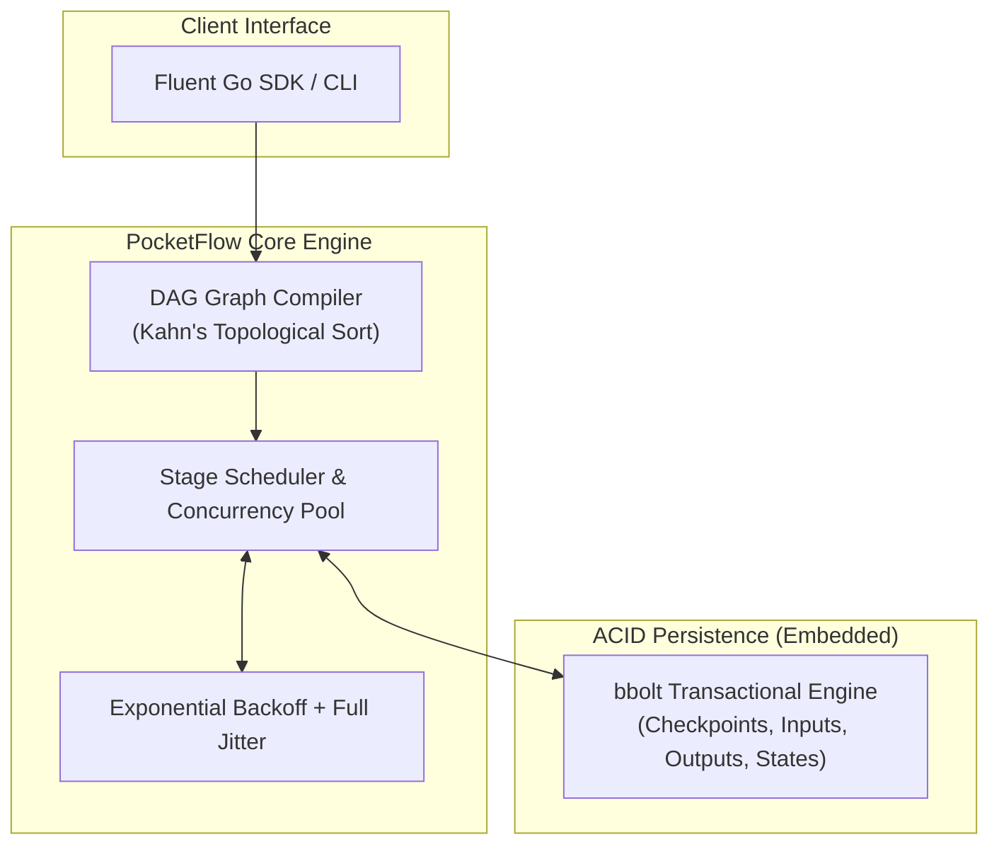

<div align="center">

```
  ____            _        _   _____ _               
 |  _ \ ___   ___| | _____| |_|  ___| | _____      __
 | |_) / _ \ / __| |/ / _ \ __| |_  | |/ _ \ \ /\ / /
 |  __/ (_) | (__|   <  __/ |_|  _| | | (_) \ V  V / 
 |_|   \___/ \___|_|\_\___|\__|_|   |_|\___/ \_/\_/  
```

### ⚡ Embedded, Zero-Dependency Durable Workflow Engine for Go

[](https://goreportcard.com/report/github.com/kemranbatcaev02-gif/pocketflow)
[](LICENSE)
[](https://golang.org)
[]()
[]()

**PocketFlow** is a lightweight, fault-tolerant workflow orchestrator and DAG execution engine in a **single static binary**.<br>
*Think SQLite, but for distributed jobs, durable background tasks, and DAG pipelines.*

[Key Features](#-key-features) •
[Why PocketFlow?](#-why-pocketflow) •
[Quickstart](#-quickstart-in-30-seconds) •
[Architecture](#-architecture) •
[CLI & Terminal UI](#-cli--terminal-ui) •
[Benchmarks](#-benchmarks)

</div>

---

## 💡 Why PocketFlow?

Heavy orchestrators like **Temporal**, **Cadence**, or **Apache Airflow** are powerful, but they require:
- Complex multi-container setups (ZooKeeper, PostgreSQL, Cassandra, Redis).
- Heavy operational burden for teams that just want reliable background pipelines.
- Hundreds of megabytes of RAM before processing a single task.

**PocketFlow solves this problem.** It gives you **Durable Execution** and **DAG dependency scheduling** with:
* 🪶 **Single Binary / Embedded:** 0 external databases. All state checkpoints are saved to a pure-Go ACID transactional engine (`bbolt`).
* 🔄 **Crash Recovery (Durable Execution):** If your server loses power (`kill -9`), restart PocketFlow and it automatically resumes from the exact failure point, **skipping already completed steps**.
* 🕸️ **Mathematical DAG Scheduler:** Computes parallel execution stages using Kahn's topological sort and detects circular dependencies at initialization time.
* 🛡️ **Production-Grade Resilience:** Configurable worker pools, step timeouts, and Exponential Backoff with full randomized jitter.
* 💅 **Beautiful Developer Experience:** Fluent chaining API in Go + styled Lipgloss terminal dashboard.

---

## 📊 Feature Comparison

| Feature | ⚡ **PocketFlow** | 🐘 Temporal | 🐍 Apache Airflow | 🐇 Celery |
| :--- | :---: | :---: | :---: | :---: |
| **External DB Required** | ❌ **None** (Embedded) | ✅ Postgres / Cassandra | ✅ Postgres / MySQL | ✅ Redis / RabbitMQ |
| **Docker Required to Run** | ❌ **No** (Single Binary) | ✅ Yes | ✅ Yes | ⚠️ Recommended |
| **RAM at Idle** | **< 15 MB** | ~500 MB+ | ~1.2 GB+ | ~150 MB |
| **Startup Time** | **~0.01 sec** | ~15-30 sec | ~45-90 sec | ~2-5 sec |
| **DAG Parallel Execution** | ✅ Native Stages | ✅ Yes | ✅ Yes | ❌ Basic chains |
| **Crash-Resume Checkpoints** | ✅ Built-in | ✅ Yes | ⚠️ Partial | ❌ No |
| **Language Dependency** | **Pure Go (Zero CGO)** | Go + Java/Temporal CLI | Python + JVM/C deps | Python |

---

## 🚀 Quickstart in 30 Seconds

### 1. Installation

```bash
go get github.com/kemranbatcaev02-gif/pocketflow@latest
```

### 2. Define and Run a Workflow

```go
package main

import (
    "context"
    "fmt"
    "time"

    "github.com/kemranbatcaev02-gif/pocketflow/internal/tui"
    "github.com/kemranbatcaev02-gif/pocketflow/pkg/pocketflow"
)

func main() {
    // 1. Initialize embedded engine (creates pocketflow.db)
    app, err := pocketflow.NewApp("pocketflow.db")
    if err != nil {
        panic(err)
    }
    defer app.Close()

    // 2. Define workflow with DAG dependencies & retries
    err = app.Workflow("order-pipeline").
        Step("validate_cart", func(ctx *pocketflow.StepContext) (any, error) {
            return map[string]any{"order_id": "ORD-101", "total": 99.50}, nil
        }).
        Step("charge_card", func(ctx *pocketflow.StepContext) (any, error) {
            var cart map[string]any
            _ = ctx.BindInput("validate_cart", &cart)
            return map[string]string{"txn_id": "tx_99812", "status": "approved"}, nil
        }).After("validate_cart").WithRetries(3).WithBackoff(200*time.Millisecond, 2.0, 2*time.Second).
        Step("reserve_inventory", func(ctx *pocketflow.StepContext) (any, error) {
            return map[string]string{"warehouse": "US-WEST-1", "reserved": "true"}, nil
        }).After("validate_cart").
        Step("send_receipt", func(ctx *pocketflow.StepContext) (any, error) {
            return map[string]bool{"sent": true}, nil
        }).After("charge_card", "reserve_inventory").
        Done()

    if err != nil {
        panic(err)
    }

    // 3. Execute!
    state, err := app.Run(context.Background(), "order-pipeline", nil)
    if err != nil {
        panic(err)
    }

    // 4. Render sleek terminal breakdown
    summary, _ := app.GetWorkflow(state.RunID)
    fmt.Println(tui.RenderWorkflowSummary(summary))
}
```

---

## 🖥️ CLI & Terminal UI

PocketFlow includes a standalone CLI tool for inspecting and managing workflows.

```bash
# Build the CLI
go build -o pocketflow ./cmd/pocketflow

# Run the interactive eCommerce demo pipeline
./pocketflow demo

# List all recorded workflow executions
./pocketflow list

# Inspect a specific run ID with full breakdown
./pocketflow status <run-id>
```

### Terminal Output Preview:

```text
╭───────────────────────────────────────────────────╮
│   ⚡ PocketFlow   Durable Workflow Engine for Go  │
╰───────────────────────────────────────────────────╯

Workflow ID: order-fulfillment-pipeline
Run ID     : 8d78bf44-6b11-4bce-bb6b-14483af00e96
Status     : ✔ COMPLETED
Duration   : 1.086s

Step Execution Breakdown:

  STEP                         STATUS           ATTEMPT    TIME       DETAILS
────────────────────────────────────────────────────────────────────────────────
  validate_cart                ✔ COMPLETED      1/3        124ms      {"amount":250,"order_id":"ORD-99...
  charge_credit_card           ✔ COMPLETED      2/3        158ms      {"card":"**** 4242","txn_id":"TX...
  reserve_warehouse_stock      ✔ COMPLETED      1/3        146ms      {"reserved":"true","warehouse":"...
  generate_tax_invoice         ✔ COMPLETED      1/3        86ms       {"invoice_no":"INV-2026-00441"}
  notify_customer_sms          ✔ COMPLETED      1/3        66ms       {"sms_status":"delivered"}
```

---

## 🏛️ Architecture

PocketFlow is designed around three decoupled layers:



### Crash-Recovery Guarantee
1. Before every step transition, a checkpoint is committed inside a read-write transaction in `bbolt`.
2. Step inputs and outputs are preserved in JSON.
3. When `app.Resume(ctx, runID)` is invoked:
   - Steps marked `COMPLETED` are loaded from disk and **not rerun**.
   - Interrupted or failed steps are scheduled for immediate retry.

---

## ⚡ Benchmarks

Benchmarks executed on **12th Gen Intel(R) Core(TM) i5-12500H** (Windows amd64):

| Benchmark | Operations | Latency | Memory / Op | Allocations |
| :--- | :---: | :---: | :---: | :---: |
| **`DAG_TopologicalSort` (100-node graph)** | 35,841 | **34.6 µs / op** | 23.4 KB | 228 allocs |
| **`WorkflowExecution` (full disk checkpoints)** | — | **~500 µs / op** | 117 KB | 750 allocs |

To run benchmarks yourself:
```bash
go test -bench=Benchmark -benchmem ./pkg/pocketflow
```

---

## 📁 Repository Structure

```text
pocketflow/
├── cmd/
│   └── pocketflow/           # Standalone CLI binary (demo, list, status)
├── pkg/
│   └── pocketflow/           # Public Go SDK (App, WorkflowBuilder, Context)
├── internal/
│   ├── dag/                  # Graph data structure, cycle detector, topological sort
│   ├── storage/              # Embedded bbolt storage and ACID transactions
│   ├── engine/               # Scheduler, worker pool, backoff & crash recovery
│   ├── models/               # Domain states, status enum, step contexts
│   └── tui/                  # Lipgloss formatted terminal dashboard
├── examples/
│   ├── ecommerce/            # Full order checkout pipeline with payment retries
│   └── etl_pipeline/         # Analytical data extraction, transform & warehouse loading
├── .github/workflows/ci.yml  # Multi-platform CI (Linux, macOS, Windows)
├── LICENSE                   # MIT License
└── README.md                 # Project documentation
```

---

## 📄 License

PocketFlow is licensed under the [MIT License](LICENSE).
Feel free to use it in your personal projects, open-source tools, or commercial products!
