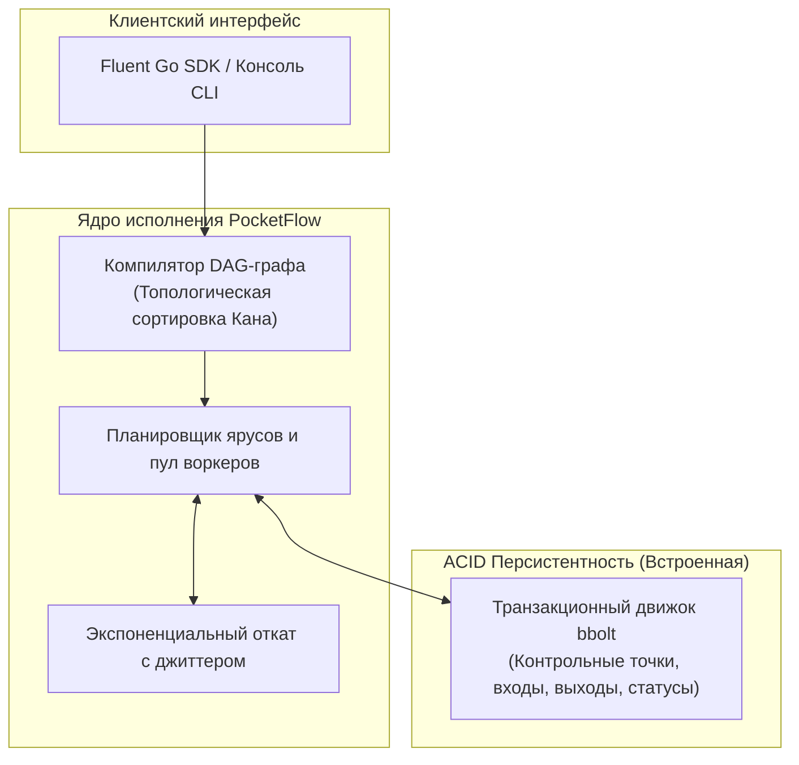

<div align="center">

```
  ____            _        _   _____ _               
 |  _ \ ___   ___| | _____| |_|  ___| | _____      __
 | |_) / _ \ / __| |/ / _ \ __| |_  | |/ _ \ \ /\ / /
 |  __/ (_) | (__|   <  __/ |_|  _| | | (_) \ V  V / 
 |_|   \___/ \___|_|\_\___|\__|_|   |_|\___/ \_/\_/  
```

### ⚡ Встраиваемый, легковесный и отказоустойчивый движок рабочих процессов (Durable Workflow Engine) для Go

[](LICENSE)
[](https://golang.org)
[]()
[]()

**PocketFlow** — это компактный отказоустойчивый оркестратор задач и планировщик DAG-графов в **одном статическом бинарном файле**.<br>
*Аналог SQLite, но для распределенных очередей, фоновых пайплайнов и устойчивых рабочих процессов.*

[Преимущества](#-почему-pocketflow) •
[Сравнение](#-сравнение-с-аналогами) •
[Быстрый старт](#-быстрый-старт-за-30-секунд) •
[Архитектура](#-архитектура) •
[Консольный интерфейс](#-консольный-интерфейс-cli--tui) •
[Бенчмарки](#-производительность-и-бенчмарки)

</div>

---

## 💡 Почему PocketFlow?

Тяжелые корпоративные оркестраторы вроде **Temporal**, **Cadence** или **Apache Airflow** мощны, но несут огромные накладные расходы:
- Требуют развертывания сложной инфраструктуры: PostgreSQL, Redis, Cassandra, ZooKeeper.
- Создают колоссальную операционную нагрузку для команд, которым просто нужны надежные фоновые пайплайны.
- Потребляют сотни мегабайт оперативной памяти в состоянии простоя еще до запуска первой задачи.

**PocketFlow решает эту проблему.** Он предоставляет гарантии **Durable Execution** (устойчивости к сбоям) и **DAG-планирования** при минимальных требованиях:
* 🪶 **Один файл / Нулевые зависимости:** Никаких внешних серверов баз данных и Docker. Контрольные точки (checkpoints) сохраняются во встроенную транзакционную ACID-базу на чистом Go (`bbolt`).
* 🔄 **Восстановление после падений (Durable Execution):** Если сервер аварийно завершил работу (`kill -9` или отключение питания), при следующем запуске PocketFlow восстанавливает состояние и продолжает выполнение ровно с места сбоя, **не перезапуская уже завершенные шаги**.
* 🕸️ **Математический планировщик DAG:** Вычисляет параллельные ярусы выполнения (алгоритм Кана) и валидирует граф на отсутствие циклических блокировок на этапе компиляции.
* 🛡️ **Промышленная надежность:** Настраиваемый пул горутин (ограничение конкурентности), таймауты шагов через `context.Context` и экспоненциальный откат со случайным разбросом (**Exponential Backoff + Jitter**).
* 💅 **Превосходный DX (Developer Experience):** Удобный Fluent API цепочек вызовов в Go и стилизованный терминальный дашборд на базе `Lipgloss`.

---

## 📊 Сравнение с аналогами

| Параметр | ⚡ **PocketFlow** | 🐘 Temporal | 🐍 Apache Airflow | 🐇 Celery |
| :--- | :---: | :---: | :---: | :---: |
| **Внешняя СУБД** | ❌ **Не требуется** (Встроена) | ✅ Postgres / Cassandra | ✅ Postgres / MySQL | ✅ Redis / RabbitMQ |
| **Обязателен ли Docker** | ❌ **Нет** (Один бинарник) | ✅ Да | ✅ Да | ⚠️ Рекомендуется |
| **Потребление RAM в простое** | **< 15 МБ** | ~500 МБ+ | ~1.2 ГБ+ | ~150 МБ |
| **Время холодного старта** | **~0.01 сек** | ~15-30 сек | ~45-90 сек | ~2-5 сек |
| **Параллельные ветки DAG** | ✅ Нативные ярусы | ✅ Да | ✅ Да | ❌ Ограниченно |
| **Возобновление после сбоя** | ✅ Встроено | ✅ Да | ⚠️ Частично | ❌ Нет |
| **Зависимости языка** | **Чистый Go (Zero CGO)** | Go + Java CLI | Python + C-библиотеки | Python |

---

## 🚀 Быстрый старт за 30 секунд

### 1. Установка модуля

```bash
go get github.com/kemranbatcaev02-gif/pocketflow@latest
```

### 2. Описание и запуск цепочки задач

```go
package main

import (
    "context"
    "fmt"
    "time"

    "github.com/kemranbatcaev02-gif/pocketflow/internal/tui"
    "github.com/kemranbatcaev02-gif/pocketflow/pkg/pocketflow"
)

func main() {
    // 1. Инициализируем приложение со встроенной базой данных (pocketflow.db)
    app, err := pocketflow.NewApp("pocketflow.db")
    if err != nil {
        panic(err)
    }
    defer app.Close()

    // 2. Описываем граф пайплайна с зависимостями и ретраями
    err = app.Workflow("order-pipeline").
        Step("validate_cart", func(ctx *pocketflow.StepContext) (any, error) {
            return map[string]any{"order_id": "ORD-101", "total": 99.50}, nil
        }).
        Step("charge_card", func(ctx *pocketflow.StepContext) (any, error) {
            var cart map[string]any
            _ = ctx.BindInput("validate_cart", &cart)
            return map[string]string{"txn_id": "tx_99812", "status": "approved"}, nil
        }).After("validate_cart").WithRetries(3).WithBackoff(200*time.Millisecond, 2.0, 2*time.Second).
        Step("reserve_inventory", func(ctx *pocketflow.StepContext) (any, error) {
            return map[string]string{"warehouse": "US-WEST-1", "reserved": "true"}, nil
        }).After("validate_cart").
        Step("send_receipt", func(ctx *pocketflow.StepContext) (any, error) {
            return map[string]bool{"sent": true}, nil
        }).After("charge_card", "reserve_inventory").
        Done()

    if err != nil {
        panic(err)
    }

    // 3. Запускаем выполнение
    state, err := app.Run(context.Background(), "order-pipeline", nil)
    if err != nil {
        panic(err)
    }

    // 4. Выводим стилизованную таблицу статуса в терминале
    summary, _ := app.GetWorkflow(state.RunID)
    fmt.Println(tui.RenderWorkflowSummary(summary))
}
```

---

## 🖥️ Консольный интерфейс (CLI & TUI)

PocketFlow включает автономную консольную утилиту для инспекции и управления пайплайнами:

```bash
# Сборка бинарного файла
go build -o pocketflow ./cmd/pocketflow

# Запуск интерактивного демо-пайплайна интернет-магазина
./pocketflow demo

# Список всех зафиксированных запусков
./pocketflow list

# Подробная детализация конкретного запуска по ID
./pocketflow status <run-id>
```

### Внешний вид терминала:

```text
╭───────────────────────────────────────────────────╮
│   ⚡ PocketFlow   Durable Workflow Engine for Go  │
╰───────────────────────────────────────────────────╯

Workflow ID: order-fulfillment-pipeline
Run ID     : 8d78bf44-6b11-4bce-bb6b-14483af00e96
Status     : ✔ COMPLETED
Duration   : 1.086s

Step Execution Breakdown:

  STEP                         STATUS           ATTEMPT    TIME       DETAILS
────────────────────────────────────────────────────────────────────────────────
  validate_cart                ✔ COMPLETED      1/3        124ms      {"amount":250,"order_id":"ORD-99...
  charge_credit_card           ✔ COMPLETED      2/3        158ms      {"card":"**** 4242","txn_id":"TX...
  reserve_warehouse_stock      ✔ COMPLETED      1/3        146ms      {"reserved":"true","warehouse":"...
  generate_tax_invoice         ✔ COMPLETED      1/3        86ms       {"invoice_no":"INV-2026-00441"}
  notify_customer_sms          ✔ COMPLETED      1/3        66ms       {"sms_status":"delivered"}
```

---

## 🏛️ Архитектура

Архитектура PocketFlow разделена на три изолированных слоя:



### Гарантия устойчивости (Crash Recovery)
1. Перед изменением статуса любого шага транзакция атомарно фиксируется в `bbolt`.
2. Входные и выходные данные шагов сохраняются в формате JSON.
3. При вызове `app.Resume(ctx, runID)`:
   * Шаги со статусом `COMPLETED` загружаются с диска и **не исполняются повторно**.
   * Шаги, прерванные падением процесса, немедленно продолжают выполнение.

---

## ⚡ Производительность и бенчмарки

Замеры производительности на процессоре **12th Gen Intel(R) Core(TM) i5-12500H** (Windows amd64):

| Бенчмарк | Количество операций | Задержка | Память / Оп | Аллокации |
| :--- | :---: | :---: | :---: | :---: |
| **`DAG_TopologicalSort` (граф на 100 узлов)** | 35 841 | **34.6 мкс / оп** | 23.4 КБ | 228 allocs |
| **`WorkflowExecution` (полные ACID-снапшоты на диск)** | — | **~500 мкс / оп** | 117 КБ | 750 allocs |

Запуск бенчмарков:
```bash
go test -bench=Benchmark -benchmem ./pkg/pocketflow
```

---

## 📁 Структура проекта

```text
pocketflow/
├── cmd/
│   └── pocketflow/           # Консольная утилита CLI (demo, list, status)
├── pkg/
│   └── pocketflow/           # Публичный Go SDK (App, WorkflowBuilder, Context)
├── internal/
│   ├── dag/                  # Граф задач, поиск циклов, топологическая сортировка
│   ├── storage/              # Встроенное хранилище bbolt и ACID транзакции
│   ├── engine/               # Планировщик, пул воркеров, обработка сбоев
│   ├── models/               # Доменные сущности, статусы, контексты
│   └── tui/                  # Форматированный терминальный вывод (Lipgloss)
├── examples/
│   ├── ecommerce/            # Пайплайн оформления заказа с повторами оплаты
│   └── etl_pipeline/         # Аналитический сбор, трансформация и загрузка данных
├── LICENSE                   # Лицензия MIT
└── README.md                 # Документация проекта
```

---

## 📄 Лицензия

Проект лицензирован под [MIT License](LICENSE).  
Разрешено свободное использование в учебных, личных и коммерческих проектах.
